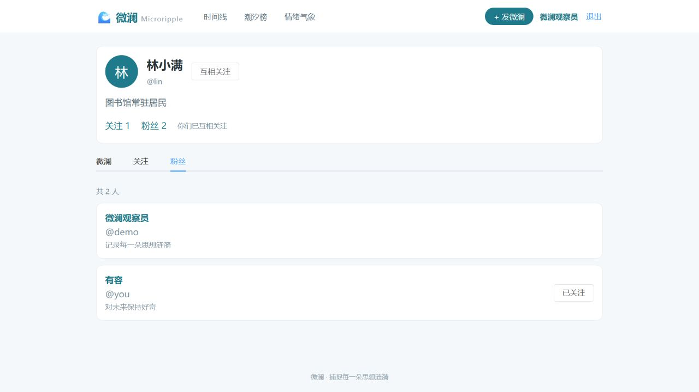
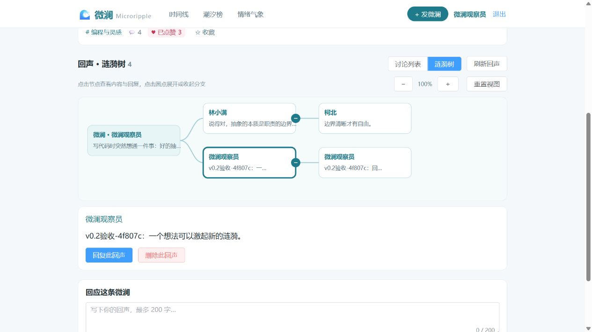

# 微澜 v0.2 完整验收记录

日期：2026-10-25。完整开发分支：`feat/v0.2-complete`。前后端版本：`0.2.0`。

## 路线图要求与完成情况

| 要求 | 已实现行为 |
| --- | --- |
| 点赞关系闭环 | 点赞/取消、重复请求不重复计数、刷新恢复本人状态、首页及详情同步 |
| 收藏关系闭环 | 收藏/取消、本人收藏分页、详情入口、列表内取消、末页回退、空列表引导 |
| 关注关系闭环 | 关注/取消、互关状态、关注/粉丝计数及分页列表、他人主页、关注作者时间线 |
| 回声互动 | 发表、对回声回复、可选情绪、输入校验、最多 8 层回复、作者或管理员删除子树 |
| 涟漪树可视化 | 编译式递归组件展示真实讨论；SVG 节点与连线、分支展开收起、缩放、重置、选中节点查看完整内容并回复 |
| 潮汐算法完善 | 微澜/回声/点赞初始权重 10/5/2，每项贡献每 72 小时减半；箭头比较最近 24 小时与前 24 小时互动分 |

继续使用现有 MySQL 表和外键，模型补齐现有关注唯一约束，无需重跑清空建表脚本。页面中点击作者昵称可进入公开主页；公开主页不返回封禁原因等管理字段。

## 本轮新增接口

| 方法 | 路径 | 行为 |
| --- | --- | --- |
| GET | `/api/v1/users/{id}` | 公开主页及本人关系状态 |
| PUT / DELETE | `/api/v1/users/{id}/follow` | 关注 / 取消关注 |
| GET | `/api/v1/users/{id}/following` | 关注列表，支持 limit、offset |
| GET | `/api/v1/users/{id}/followers` | 粉丝列表，支持 limit、offset |
| GET | `/api/v1/users/{id}/ripples` | 指定作者的公开微澜 |
| GET | `/api/v1/ripples/following` | 当前用户关注作者的公开时间线，支持话题和关键词筛选 |
| POST | `/api/v1/ripples/{id}/echoes` | 发表回声，parent_echo_id 指定同一微澜内的回复对象 |
| DELETE | `/api/v1/echoes/{id}` | 作者或管理员删除回声及其所有子回复 |

原有点赞、收藏、我的收藏和管理员审核接口保留。

## 权限与边界

- 所有互动写入要求登录，封禁账号按现有规则拒绝操作；禁止关注自己。
- 关注 PUT/DELETE 均可重复调用；按固定用户 ID 顺序加锁，避免并发互关死锁。
- 回声内容去除首尾空白后为 1–200 字；回复对象必须属于当前微澜，不接受跨微澜父节点。
- 最多 8 层回复，避免过深递归导致树展示或接口响应失败。
- 非公开微澜不允许新增回声。作者可查看自己的非公开内容，其回声界面为只读。
- 删除回声要求作者或管理员权限；数据库按现有外键清理全部子回复。页面先明确确认子树删除。
- 关注时间线、公开作者列表、收藏列表、潮汐和情绪聚合均排除非公开微澜。
- 潮汐按事件自己的时间衰减；旧微澜上的新回复、点赞仍有新的贡献。基础热度不衰减。

## 测试结果

真实 MySQL 集成测试共 **49 项全部通过**，按模块分布如下：

| 模块 | 数量 |
| --- | ---: |
| 点赞 | 8 |
| 收藏 | 9 |
| 我的收藏列表 | 9 |
| 关注与关注时间线 | 9 |
| 回声、删除及统计联动 | 11 |
| 潮汐时间衰减与窗口趋势 | 3 |

覆盖重复请求、8 路并发点赞/收藏/关注、双向互关、并发回声、账号隔离、内容可见性、分页、输入校验、跨微澜回复、回复深度和删除级联。潮汐测试使用固定时钟验证半衰期、涨跌及新互动权重。

各组测试使用单独的随机临时数据库，完成后自动清理；不对开发数据库执行重建脚本。前端生产构建通过，仍有现有包体积提示。

从项目根目录复现（PowerShell，需先配置 backend/.env）：

```powershell
.\.venv\Scripts\python.exe -m pip install -r backend\requirements-dev.txt
Set-Location backend
$env:WEILAN_MYSQL_TESTS = '1'
..\.venv\Scripts\python.exe -m unittest discover -s tests -v
Remove-Item Env:\WEILAN_MYSQL_TESTS
```

## 实际页面验收

1. 在作者主页关注：粉丝数 1 → 2，显示互关；粉丝列表同步出现当前用户。取消后数量和列表恢复。
2. 首页切换“我关注的”，只展示仍在关注的作者的公开内容。
3. 回声讨论原有种子内容可正常渲染。发表临时回声并回复：总数 2 → 3 → 4，刷新后父子关系保持。
4. 切换树图，缩放至 90%、收起分支、重置恢复、选择节点查看全文并进入定向回复表单均正常。
5. 删除对话框明确提示连同子回复删除；取消确认后保持内容。
6. 通过本人删除接口清理本次带唯一验收标记的临时子树，总数恢复 2；原有关注、点赞和收藏状态保留。

关注与粉丝列表截图：



回声树图截图（包含已清理的临时验收内容）：



## 阶段提交

- `162f87e`：关注关系、公开主页、关系列表与关注时间线。
- `7030a2b`：回声发表、回复、子树删除、递归讨论及交互树图。
- 最后一阶段：潮汐时间算法、0.2.0 版本号及本文档，随完整验收结果一并提交。

本分支包含此前点赞、收藏和我的收藏成果，适合作为完整 v0.2 审核版本；审核合并到 main 后再开始后续版本。
