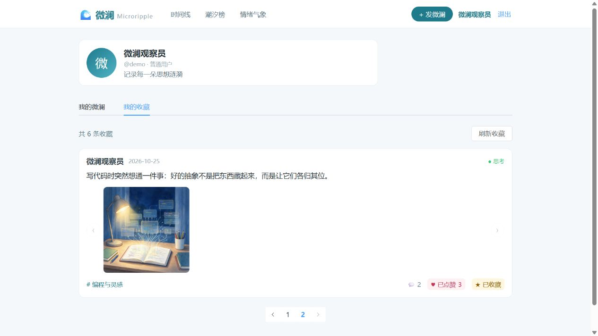

# 我的收藏列表与分页：阶段验收记录

日期：2026-10-25。开发分支：`feat/my-collections`，基于收藏功能分支继续开发。

## 本阶段成果

个人中心增加“我的微澜”和“我的收藏”标签。用户在时间线收藏内容后，可在个人中心集中查看、翻页、进入详情和取消收藏。

- 我的收藏每页展示 5 条，按收藏时间倒序排列；时间相同按收藏记录 ID 倒序排列，避免翻页顺序不稳定。
- 收藏卡片复用点赞和收藏按钮、配图预览及详情入口。
- 在末页取消最后一条收藏后，自动回到有效页面；总数与列表重新读取服务端结果。
- 空列表展示引导和时间线入口；加载失败可重试，加载时禁用翻页。
- 通过 `/profile?tab=collections` 可直接进入我的收藏；从详情返回时仍保留该标签。
- 在收藏卡片点赞时同步本页和“我的微澜”中的对应计数。

## 新增接口

`GET /api/v1/interactions/collections?limit=5&offset=0`

需要登录，返回 `items`、`total`、`limit`、`offset`。其中 items 为微澜列表，包含本人点赞/收藏状态以及点赞、回声数量。

limit 范围为 1–100，offset 不小于 0。只返回当前用户收藏且仍公开的内容；下架、待审核和已删除内容不会出现在列表或总数中，即使当前用户就是作者。列表与数量使用相同过滤条件。

复用现有 collections 表，无需重建开发数据库。

## 自动化验证

新增 9 项真实 MySQL 集成测试，连同原有 17 项共 26 项全部通过。

| 新增用例 | 结果 |
| --- | --- |
| 分页、总数及收藏时间倒序 | 通过 |
| 下架/待审核内容先过滤再分页，作者也不例外 | 通过 |
| 不同用户仅能读取自己的收藏 | 通过 |
| 本人点赞/收藏状态与点赞、回声计数 | 通过 |
| 取消末页最后一条后，总数和有效页正确 | 通过 |
| 空列表与越界页返回正确 | 通过 |
| 收藏时间相同的稳定次级排序 | 通过 |
| 未登录、封禁与非法分页参数 | 通过 |
| 收藏后的内容被下架或删除时从列表消失 | 通过 |

前端 Vite 生产构建通过，仍有原有包体积提示。

从项目根目录复现测试（PowerShell，需先配置 backend/.env）：

```powershell
.\.venv\Scripts\python.exe -m pip install -r backend\requirements-dev.txt
Set-Location backend
$env:WEILAN_MYSQL_TESTS = '1'
..\.venv\Scripts\python.exe -m unittest discover -s tests -v
Remove-Item Env:\WEILAN_MYSQL_TESTS
```

测试使用独立临时数据库，完成后自动清理。

## 页面验收

在演示账号上记录初始收藏状态，再临时收藏 6 条现有公开内容，完成以下操作：

1. 直接进入个人中心我的收藏，显示 6 条收藏，第一页 5 条。
2. 点击下一页，第二页仅显示 1 条，分页正确选中第 2 页。
3. 取消第二页唯一一条收藏，自动回到第一页，显示剩余 5 条。
4. 点击收藏卡片正文进入详情，返回后仍在我的收藏标签。
5. 恢复演示前的收藏状态；刷新后显示 0 条和空列表引导。

截图为步骤 2 的实际页面。所有临时演示收藏已恢复为原状态。



## 后续

本阶段单独提交并推送，供组员审核；与回声模块合并后继续进行整体联调，并按课程要求整理提交记录、测试结果和演示材料。
